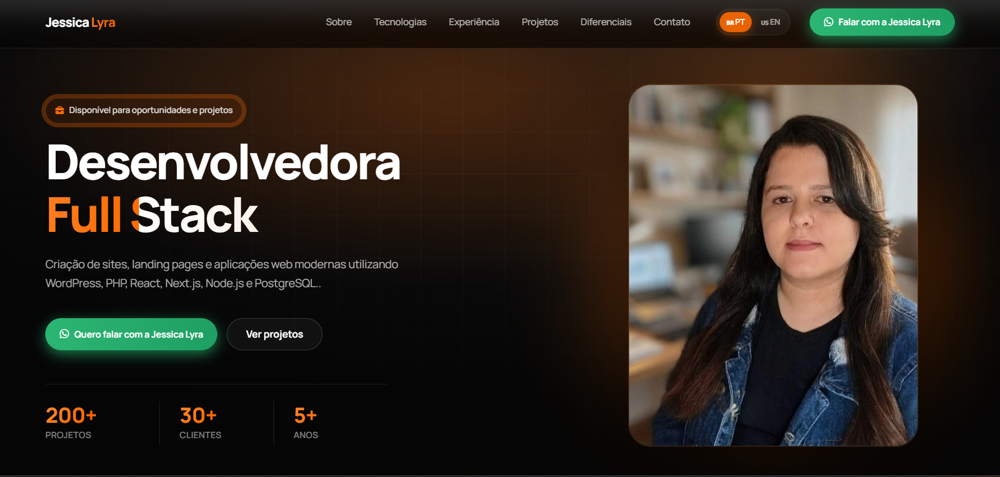

# 👋 Olá, eu sou Jessica Lyra

Desenvolvedora Web | WordPress • React • Next.js • TypeScript

Este repositório contém o código-fonte do meu portfólio profissional, construído com React e Vite.

🌐 **Portfólio:** https://jessicalyra.github.io/

---

## Desenvolvimento

Requisitos: Node.js 20.19+ e npm.

```bash
npm install
npm run dev
```

Comandos disponíveis:

```bash
npm run lint
npm run build
npm run preview
```

O build de produção é gerado na pasta `dist/`. O projeto mantém as páginas `/`, `/en/` e `/planos.html` como entradas estáticas compatíveis com GitHub Pages.

O workflow em `.github/workflows/deploy.yml` executa lint, build e publicação do `dist/` no GitHub Pages. Nas configurações do repositório, selecione **Settings → Pages → Build and deployment → GitHub Actions**.

`npm run format` aplica o padrão Prettier; `npm run format:check` verifica a formatação.

## Estrutura

- `src/components/`: cabeçalho, rodapé e modal reutilizáveis.
- `src/pages/`: composição das páginas e componentes de cada seção.
- `src/hooks/`: hooks de comportamento compartilhado.
- `assets/css/`: estilos existentes do portfólio.
- `public/assets/img/`: imagens e ícones servidos pelo Vite.

---

## Preview



---

## Sobre

Meu portfólio reúne projetos profissionais, projetos pessoais e minha trajetória como Desenvolvedora Web, demonstrando minha evolução técnica e experiência com diferentes tecnologias.

---

## Tecnologias

### Front-end

- HTML5
- CSS3
- JavaScript
- React
- Next.js
- TypeScript
- Tailwind CSS

### Back-end

- Node.js
- Prisma ORM
- PostgreSQL
- JWT
- bcrypt

### WordPress

- WordPress
- Elementor
- PHP

### Ferramentas

- Git
- GitHub
- Vite
- Vercel
- VS Code

---

## Funcionalidades

- ✅ Portfólio responsivo
- ✅ Projetos profissionais
- ✅ Projetos pessoais
- ✅ Versão em português
- ✅ Versão em inglês
- ✅ Demonstrações em vídeo
- ✅ Links para projetos publicados

---

## Contato

- 🌐 Portfólio: https://jessicalyra.github.io/
- 💼 LinkedIn: https://www.linkedin.com/in/jessica-lyra-dev/
